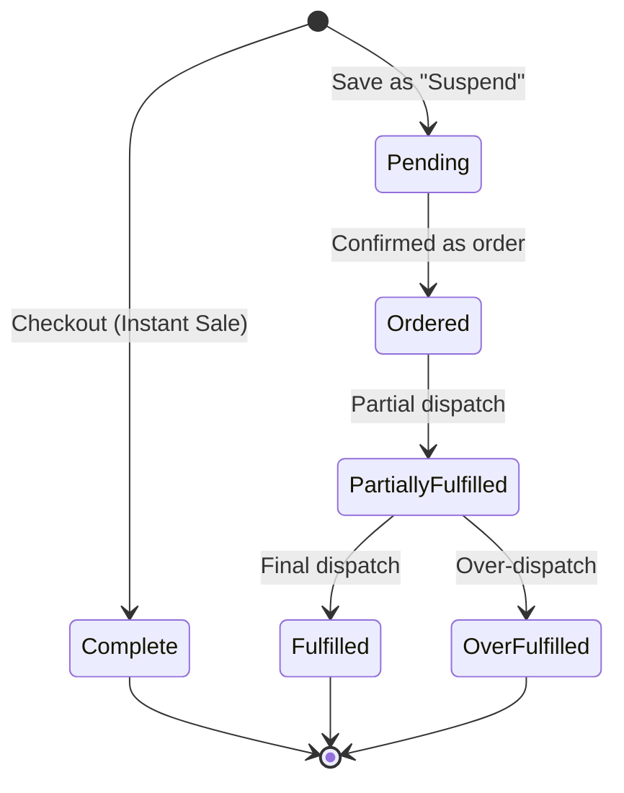
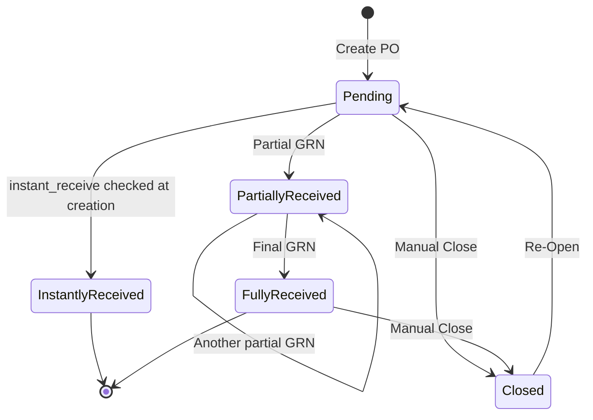
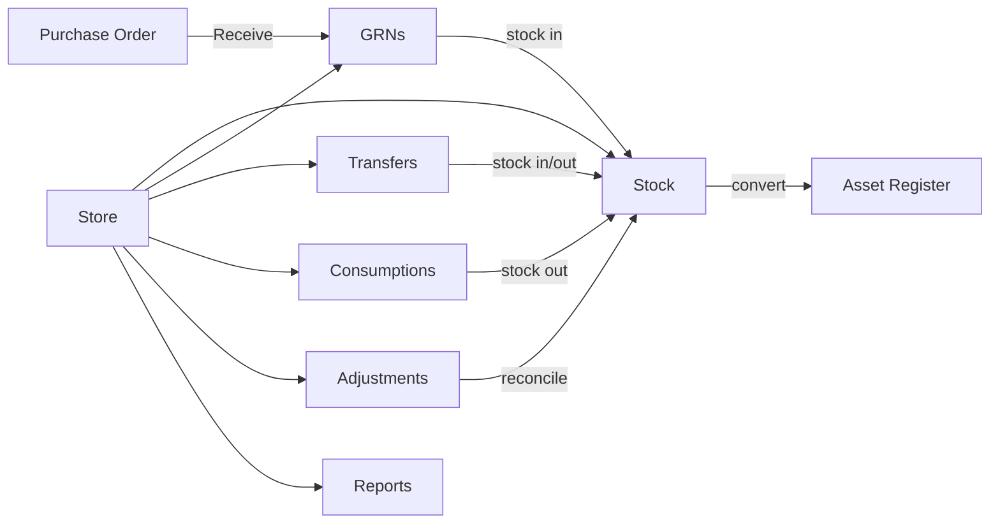

# ProsERP — Business Flow & UI/UX Specification

## POS Module · Procurement & Supply (Purchases→Receiving, Consumptions, Reports) · Procurement Masters: Stores

> Source: reverse-engineered from the ProsERP frontend (`c:\work\live-repo`), a Next.js App Router + TypeScript BFF application. All business rules described as "backend" are inferred from frontend validation/payload shapes — actual server-side enforcement lives in the external REST API, not in this repo.

---

## 0. Shared architectural patterns (apply across all modules below)

- **BFF proxy**: every `src/app/api/<module>/**/route.ts` is a thin pass-through (`getAuthHeaders` → `fetch` → `handleJsonResponse`) to an external REST backend. No business logic lives in Next.js routes.
- **Module gating**: every top-level page checks `organizationHasSubscribed(MODULES.X)` (→ `UnsubscribedAccess` if not) then one or more `PERMISSIONS.X_*` (→ `UnauthorizedAccess` if not).
- **Inline item-entry UX**: forms with line items (Sale, Purchase Order, GRN, Proforma, Price List, Inventory Consumption) all share one pattern — an "add row" sub-form that collapses into a compact summary row once added, re-opens on click to edit in place, and on Submit, if the sub-form still has unsaved input, a dialog offers **"Add and Submit"** vs **"Submit without add."**
- **Ledger-centric accounting**: every money- or stock-value-moving action posts against a selected **Ledger** (cash/bank for instant pay, supplier payable, receivable for cost-center reroutes, expense/income ledgers for costs/adjustments). The frontend only _selects_ ledgers; posting logic is backend-side.
- **Store as the inventory primitive**: `store_id` scopes every stock-affecting transaction (GRN receive, transfer, adjustment, consumption). Stores form a parent/child tree (sub-stores) with roll-up ("include children") reporting.
- **Cost Center scoping**: nearly every transaction (PO, GRN, consumption, adjustment, sale) is tied to ≥1 Cost Center, used for both accounting attribution and access scoping.
- **Backdate/Postdate permission pairs**: almost every create/edit form bounds its date field using a `<Module>_BACKDATE` / `<Module>_POSTDATE` permission pair plus the org's `recording_start_date`.

---

## 1. POS Module

### 1.1 Menu structure

```
POS (section, gated: MODULES.POINT_OF_SALE)
├── Sales (collapsible)
│   ├── Sales Counter   → /pos/sales-counters   (core transaction screen)
│   └── Proformas       → /pos/proformas        (quotations)
├── Reports             → /pos/reports
└── Masters (collapsible)
    ├── Outlets          → /pos/outlets          (sales locations)
    ├── Price Lists      → /pos/price_lists      (sell-price catalogs)
    └── Settings         → /pos/pos-settings     (module settings)
```

### 1.2 Masters → Outlets

**Business flow**: An **Outlet** is the top-level "store front" entity — a physical or logical sales point. It owns:

- One or more **Sales Counters**, each mapped to one or more accounting **Ledgers** (the till/cash accounts instant payments settle into — this _is_ the till; there is no separate shift/clock-in model).
- One or more **Stores** it is allowed to sell from / deduct stock from.
- An optional restriction to specific **Product Categories** (empty = sell anything).
- Either a list of **Users** who may operate it, _or_ — if Project Management is subscribed — a linked **Project**, whose cost-center/team substitutes for a manual user list.

**UI/UX flow**:

1. List page (`Outlets`) — columns: Name + Type, Address, Store chips, Counter/User badge counts, row action menu.
2. **Create/Edit dialog** (`OutletFormDialog`):
   - Name*, Type* (work center | shop | fuel station | manufacturing)
   - Address
   - Project (optional, swaps the Users field for a read-only project-team chip list)
   - Counters[] — repeatable: Name* + Ledger Accounts* (multi-select, min 1)
   - Stores* (multi-select, min 1, sub-stores allowed)
   - Product Categories (multi-select, optional)
   - Users* (multi-select, required unless Project linked)
3. Row actions: **Edit** only (Delete exists in code but is not wired to the menu — effectively disabled).
4. `OutletSelector` (reused across Sales Counter/Price Lists/Proformas/Reports) auto-injects an "All Outlets" aggregate option when a user has >1 outlet, auto-selects the sole outlet otherwise.

### 1.3 Masters → Price Lists

**Business flow**: A **Price List** is a dated, per-outlet, per-product-unit sell-price catalog. It feeds the auto-filled selling price on the Sales Counter's item form. Each item carries both a **Price** and a **Bottom Cap** (the floor price a cashier cannot discount below).

**UI/UX flow**:

1. List — Effective Date, Narration, row actions (View/Edit/Delete, state-gated by permission).
2. **Create/Edit form**:
   - Effective Date & Time*, Applicable Outlets* (multi, min 1), Narration
   - Optional "Cost Insights" toggle → Store + Cost Center pickers show a reference Average Cost per item (not persisted — a margin-check aid only)
   - Items[]: Product*, Unit* (not already used for that product in this list), Price*, Bottom Cap* (unless fuel price list), Price auto-fills when Bottom Cap is edited
   - Same "unsaved item" Add-and-Submit / Submit-without-add guard
3. **Excel import** path: separate dialog — pick date + outlets, download template or upload `.xlsx`.
4. View renders as PDF.
5. Reused (via a `fuelPriceLists` flag) for the Fuel Stations module's own price lists against a different backend endpoint.

### 1.4 Masters → Settings

Thin wrapper around a shared, data-driven `ModuleSettings` editor keyed to the POS module id. The one setting referenced elsewhere in the codebase: **`POS_DEFAULT_VAT_INCLUSIVE`** — whether new Sales/Proformas default VAT-inclusive pricing on or off.

### 1.5 Sales → Sales Counter (the core POS screen)

**Business flow — till/counter selection**: User picks an Outlet + Counter (`CounterSelector`). This pair _is_ the till. If the user has access to multiple outlets, an "All Outlets" read-only aggregate mode is available (new-sale creation disabled in that mode).

**Business flow — Sale lifecycle**:



Two independent flag sets ride on top of status: `is_instant_sale`, `is_fully_paid`, `is_receiptable`, `is_invoiceable`, `is_invoiced`, `has_receipts`, `vfd_receipt` (fiscal receipt already posted — Tanzania VFD/TRA).

- **Instant Sale** (toggle): stock deducts immediately at Checkout, payment settles immediately into the counter's ledger. No customer required (defaults to "Walk-in Customer").
- **Order Sale** (Instant Sale off, requires a real customer): no immediate stock requirement; inventory is deducted later via **Dispatch**. Supports partial fulfillment.

**UI/UX flow — creating a sale** (`SaleDialogForm`):

1. Header: Transaction Date, Currency+Exchange Rate, Client (quick-add available), Reference, Payment Method (instant | on_account — on_account only once a real customer is picked), Debit/Receiving Account (counter ledger or customer receivable ledger), Sales Person, Remarks, VAT toggle.
2. Optional **Asset Booking** quick-add (if subscribed) — attaches/creates a booking inline, auto-adds a billable line item.
3. **Line items** (inline add/edit pattern): Product select (scoped to outlet's allowed categories) → for Inventory products with Instant Sale on: Store + live Available Balance → Quantity (unit-aware, balance-validated) → Price / Price-VAT-Inclusive (linked, auto-computed; read-only if user lacks price-edit permission) → Amount.
4. **Quick Add by SKU** — barcode/keyboard-wedge-scanner field: type/scan SKU → Enter → appends a line at the outlet's first store at catalog price.
5. "Suggest Recent Price" toggle (keys off the selected customer's purchase history).
6. Live summary panel (Total / VAT / Grand Total), optionally mirrored to a connected VFD pole display.
7. Submit: **Suspend** (no completion permission needed) vs **Checkout** (needs `SALES_COMPLETE` + a Debit Ledger).
8. Editing locks progressively: header fields lock once invoiced/delivery-noted/backdated-without-permission; items lock entirely once invoiced or delivery-noted (unless `SALES_MODIFY_AFTER_RECEIPT`).

**UI/UX flow — sale row & sub-flows** (accordion row, expands to tab strip):

- **Row actions**: Receipt, View, Attachments, Edit, Delete — each conditionally shown by sale state (see detailed gating in the deep-dive report; e.g. Delete blocked once anything has been dispatched).
- **Dispatches tab** (order sales only): create a Dispatch (Date, From/Destination/Vehicle/Driver, Store, per-item dispatch qty ≤ remaining) → produces a **Delivery Note**. This is where stock actually leaves for order-type sales.
- **Receipts tab**: record payments against the sale (Date, Receiving Ledger, Currency, Amount ≤ remaining, Reference) — shown for non-instant or on-account instant sales.
- **Invoices tab** (Accounts personnel): converts un-invoiced delivery notes (or the sale's own items for instant sales) into a formal AR Invoice (Reference, VAT%, is-Tax-Invoice toggle, Terms). Invoices can be marked paid/unpaid and support edit/delete.
- **Adjustments tab**: debit/credit notes against an invoice (Product, Complement Ledger, Qty, Rate) — implemented as generic accounting debit/credit transactions, not a POS-native entity.
- **Fiscalization (VFD)**: if the org is TRA-connected, a receipt must be posted to the fiscal device before it's final (editable TIN/VRN/Name first); the resulting `verification_url`/`verification_code` makes the receipt immutable.

### 1.6 Sales → Proformas

**Business flow**: A Proforma is a quotation — same item shape as a Sale, but with no stock/payment commitment, plus an Expiry Date. "Convert to Sale" does **not** mutate the Proforma — it creates an independent new Sale pre-filled from the proforma's data; the proforma is left as-is.

**UI/UX flow**:

1. List — Proforma No./Date, Client, Expiry, computed Status chip (valid/expired), Amount.
2. Form: Proforma Date, Expiry Date (≥ proforma date), Currency, Client (quick-add), Reference, Remarks (suggests from history), VAT toggle, line items (Product/Qty/Unit/Rate/Description).
3. Actions: View (PDF/on-screen), **Sale** (opens a cut-down Sale form pre-filled from the proforma — Counter, Payment Method, per-item Store+Balance when Instant Sale is on, Rate carried over read-only), Attachments, Edit, Delete.

### 1.7 Reports

Card-grid launcher, deep-linkable via `?report=`:

| Report                                                                             | Shows                                                                                                                                                                                       |
| ---------------------------------------------------------------------------------- | ------------------------------------------------------------------------------------------------------------------------------------------------------------------------------------------- |
| **Cashier Report**                                                                 | Per selected Ledger(s) + date range: Opening Balance → all in/out transactions → Closing Balance. Functions as the module's till-reconciliation report (no formal shift open/close exists). |
| **Sales Manifest**                                                                 | Transaction-level listing (Outlet/Counter/Client/Salesperson/date filters), Summary totals, Cash-Collection-Distribution breakdown, line-item detail. Excel/PDF export.                     |
| **Sales & Cash Summary**                                                           | Revenue, Payments-by-ledger, Credit Sales vs Payments Received, Fuel-Voucher table (fuel tie-in). Excel/PDF export.                                                                         |
| **Sales Performance**                                                              | Ranks Customers or Sales People by Amount Ordered/Collected, expandable per-product breakdown. Excel/PDF export.                                                                            |
| **Product Sales Report** _(launched from the Sales Counter toolbar, not this hub)_ | Ranks products sold in a counter/date range: Qty, Amount Ordered vs Dispatched vs Received.                                                                                                 |

---

## 2. Procurement & Supply — Purchases → Receiving, Consumptions, Reports

### 2.1 Menu structure (scope of this section bolded)

```
Procurement & Supply (section, gated: MODULES.PROCUREMENT_AND_SUPPLY)
├── RFQs                    (out of scope)
├── Approved Purchases       — an alternate PO-creation entry point, sourced from an
│                              approved requisition; feeds into the SAME PO→GRN pipeline below
├── **Purchases**            → /procurement/purchases
├── **Consumptions**         → /procurement/consumptions
├── **Reports**               → /procurement/reports
└── Masters (collapsible)     — Product Categories, Products, Stores (Stores covered in §3)
```

### 2.2 Purchases → Receiving (GRN) — full lifecycle



**Creating a Purchase Order** (`PurchaseOrderDialogForm`, 3 tabs — Items / Additional Costs / Terms & Remarks, + a persistent Order Summary panel):

1. **Top info**: Order Date (backdate/postdate-gated), Vendor (Stakeholder selector; a synthetic "Cash Purchase" option appears if the user holds `PURCHASES_INSTANT_PAY`, with inline quick-add-supplier), Reference, Date Required, Currency+Exchange Rate (locked if the vendor's ledger pins a currency), Cost Centers* (multi, min 1).
   - Picking a vendor auto-toggles `instant_pay`/`instant_receive` defaults — both forced true for "Cash Purchase", both default false for a real vendor (still user-togglable if permitted).
2. **Items tab**: Product/Service (quick-add inline), Quantity (unit-aware), VAT checkbox (org default, forced 0 if product is VAT-exempt), Price ↔ Price-VAT-Inclusive (linked), live Amount. "Suggest Recent Price" toggle auto-fills from the vendor's last price for that product/currency.
3. **Additional Costs tab**: Ledger (Expenses group) + Amount, + VAT-Exempt flag (only when org setting `defer_grn_billing` is on — e.g. a statutory levy like CESS).
4. **Terms & Remarks tab** — the two short-circuits:
   - **instant_pay** (needs `PURCHASES_INSTANT_PAY`, needs a vendor first): reveals a Cash/Bank Ledger ("Pay from") → settles payment immediately at PO creation, no separate AP step.
   - **instant_receive** (needs `PURCHASES_INSTANT_RECEIVE`, only offered if any line is an Inventory product): reveals a Store selector → stock enters inventory immediately at PO creation, no separate GRN step.
   - `stakeholder_ledger_id` becomes required when `instant_pay && stakeholder_id && !instant_receive` (needs somewhere to post the supplier-liability offset).
5. Validation: order_date, currency_id, cost_centers(≥1), exchange_rate, items(≥1, each product/qty/rate > 0), plus the conditional fields above.

**Receiving (GRN creation/edit)** (`PurchaseOrderReceiveForm`, 3 tabs — Items / Additional Costs / Summary Preview):

1. **Header**: Receive Date (backdate/postdate-gated), **Store*** (the receiving warehouse — sub-stores allowed), read-only **Cost Factor** (`1 + additionalCostsTotal / receivedGoodsTotal`, the landed-cost markup), optional "Change Cost Center" (reroutes received value to a different cost center via a Receivable Ledger), Order Currency (read-only) + Exchange Rate (editable if non-base).
2. **Items tab**: only lines still having `unreceived_quantity > 0` and type Inventory/Asset. Per line: ordered/remaining qty, **Receive qty** input (≤ unreceived, whole-unit enforced for non-fractional units). **Autofill All** / **Clear All** / per-row remove. Asset-type lines get a per-unit serial/identification grid. **Partial receiving is fully supported** — multiple GRNs can be raised against one PO until fully received.
3. **Additional Costs tab**: costs pro-rated from the PO by `percentageReceived` (recalculated live as quantities change), plus GRN-only costs addable. Each: Ledger, Reference, Currency+Exchange Rate, Amount, "Owed to Supplier" checkbox (folds into unbilled amount vs already-settled elsewhere).
4. **Summary Preview tab**: read-only recap — qty, unit price, landed cost-per-unit (`rate × exchangeRate × costFactor`), line amounts — gated to users with pricing-visibility permissions.
5. **Un-receive**: a not-yet-billed GRN on a non-closed/non-instantly-received order can be fully reversed (deletes the GRN, reverses its effects), permission `PURCHASES_UNRECEIVE`.
6. **Close/Re-Open**: independent of receive status — manually closes an order (records closed timestamp + remarks) or reopens it.

**Purchase Billing** (only relevant when org setting `defer_grn_billing` is on): bills either a whole GRN in one lump (inventory path) or itemized against a PO directly (non-inventory/service path, avoiding double-billing of costs already covered by a GRN). Supports Bill/Due dates, references, narration, flat VAT%, free-form Adjustments (withholding tax/retention/discount — ledger + addition/deduction + amount, optionally scoped to specific items), live Net-Payable preview, and a mark-paid/unmark-paid/cancel/reverse-cancellation lifecycle.

**List view** (`PurchasesOrdersList`): accordion rows — Order No./Requisition No., Order Date, Reference, Supplier + Cost Center chips, Status chip, Billed/Unbilled chip, Amount (permission-gated), attachment badge. Filters: date range, Status, Billing Status (if `defer_grn_billing`), Cost Centers, free text. Expanding reveals row actions (Delete/Close-ReOpen/GRNs Report/Attachments/Edit/Receive/Create Bill/View) plus a nested GRNs sub-list (date, GRN No., Billed chip, Store, per-GRN actions: Unreceive/Edit/Attachments/View/Create Bill).

### 2.3 Consumptions

**Business flow**: Records stock consumed out of a store against a Cost Center — the mechanism for issuing raw materials into Manufacturing (when the cost center is a Work Center and Manufacturing & Processing is subscribed, it can link to a **Production Batch** in progress) or general internal use, independent of the Purchases pipeline.

**UI/UX flow** (single-screen dialog, no tabs — same inline-item pattern):

1. Header: Consumption Date (backdate/postdate-gated), Store (sub-stores allowed), Cost Center* (single), optionally "Used In" = Production Batch (Work Center cost centers under Manufacturing only), Narration* (required).
2. Items: Product (Inventory-type only) → live **Available Balance** (store+cost-center+date-scoped, net of other staged lines) → Quantity (unit-aware, balance- and negative-balance-guarded) → **Corresponding Ledger*** (Expenses/Fixed Assets — the debit side) → Description.
3. A consumption raised by another process (e.g. a requisition issue) is read-only here (`is_editable: false`) — only deletable/reissuable from its origin.

**List view**: Consumption Date, Consumption No., Cost Center chip, Narration, row actions (View/Edit/Attachments/Delete — date/backdate/is_editable gated).

### 2.4 Reports (Procurement & Supply)

Card-grid launcher gated by `PURCHASES_REPORTS` (Product Insights shown regardless), deep-linkable via `?report=`:

| Report                 | Shows                                                                                                                                                                  |
| ---------------------- | ---------------------------------------------------------------------------------------------------------------------------------------------------------------------- |
| **Product Insights**   | Per product: Latest Avg Cost, Latest Selling Price, Potential Profit, per-store Stock Availability (Balance/Avg Cost/Value). No export — on-screen only.               |
| **Purchases Report**   | Order-level listing in range: Order Date/No., Supplier, Cost Centers, Order/Received/Balance Amount (foreign + base currency), grand total. PDF + Excel export.        |
| **Purchases Manifest** | Item-level (not order-level): Order Date, Date Required, Order No., Product detail, Unit, Qty Ordered vs Received, Rate, Currency, Vendor, Status. PDF + Excel export. |

_(A 4th, order-scoped "GRNs Report" exists off the Purchases list row action rather than this hub — all GRNs raised against one specific order, with Excel export.)_

---

## 3. Procurement Masters → Stores

### 3.1 Procurement Masters overview

| Menu item          | Purpose                                                         |
| ------------------ | --------------------------------------------------------------- |
| Product Categories | Classification tree for products                                |
| Products           | The product/service catalog itself                              |
| **Stores**         | Physical/logical inventory locations — see full breakdown below |

### 3.2 Stores — route structure

- **List page** (`/procurement/stores`): Store Name (→ navigates to profile), Alias, Description, Actions. Toolbar: search + "+ New store" (dialog, no `parentOptions` ⇒ top-level store).
- **Profile page** (`/procurement/stores/[id]`): header + a sidebar tree of sub-stores (desktop) / a mobile store-switcher + main content area driven by **tabs**.

### 3.3 Store data model

```ts
Store {
  id, name, alias?, description?,
  parent_id?,       // sub-store hierarchy (tree)
  users?: User[],   // assigned managers/operators
  is_active?,
  created_at, updated_at
}
```

Deliberately minimal on the frontend — **no** type/status toggle exposed in the form, **no** cost-center field on the Store master itself (cost centers are linked only at the transaction level — transfers, adjustments, consumptions). `parent_id` + a required-when-sub-store validation rule is what builds the tree; self-parenting is explicitly blocked.

### 3.4 Store profile — tab-by-tab business logic



| #   | Tab              | Gate                        | Business logic                                                                                                                                                                                                                                                                                                                                                                                                                                                |
| --- | ---------------- | --------------------------- | ------------------------------------------------------------------------------------------------------------------------------------------------------------------------------------------------------------------------------------------------------------------------------------------------------------------------------------------------------------------------------------------------------------------------------------------------------------- |
| 0   | **Stock**        | `STORES_READ`               | Live balance per product (+ unit, category), with an "Include Substores" roll-up toggle. Row action **Movement** opens a per-product transaction history. **Convert to Asset** (Inventory stock → Asset Register, with optional per-unit serials) shown only if Asset module subscribed + permitted + balance > 0. Toolbar: Low-Stock-Threshold CRUD (per store+product reorder points) + Stock Report export.                                                |
| 1   | **GRNs**         | (under `STORES_READ`)       | Lists every GRN that landed stock **into this store** — the direct Purchases↔Store link. Row actions: View, Attach.                                                                                                                                                                                                                                                                                                                                           |
| 2   | **Transfers**    | any `INVENTORY_TRANSFERS_*` | Three transfer types: **Internal** (within the same store tree), **External** (outside the tree, captures vehicle/driver info), **Cost Center Change** (same store, re-books value between cost centers via a receivable ledger, no physical movement). Supports **partial receiving** (Pending → Partially Received → Fully Received) via a separate Receive action shown only to the destination store, with a reversal (`unReceiveTrn`).                   |
| 3   | **Consumptions** | —                           | List-only view of consumptions scoped to this store (full form lives in the Consumptions module, §2.3).                                                                                                                                                                                                                                                                                                                                                       |
| 4   | **Adjustments**  | any `STOCK_ADJUSTMENTS_*`   | Reconciles system vs. physical stock. Fields: Reason (Opening/Stock-take/Returns/Write-off/Internal/Waste/Other), Date, Cost Center, **Stock Complement Ledger** (absorbs the value delta — Capital/Expenses/AP groups), Narration, Items (current stock auto-fetched, actual stock entered, delta computed). Supports **bulk Excel import**. Carries a **multi-level approval chain** (Approve/Reject/Hold per level) — while `in_review`, edit/delete lock. |
| 5   | **Reports**      | `STORES_REPORTS`            | Launcher for 4 store-scoped reports: Stock Report (valuation), Item Movement (per-product ledger), Stock Movement (date-range, category/cost-center filters), Dormant Stock (same component, flagged for slow/non-movers).                                                                                                                                                                                                                                    |

### 3.5 Store as a cross-module primitive

- **Purchase Order → instant_receive**: lets a PO be received into a chosen store at creation time, skipping GRN.
- **GRN**: every GRN is tied to exactly one `store_id` — this is the formal PO→GRN→Store link.
- **Transfers**: move stock between stores, or re-book cost centers in place.
- **Adjustments**: correct one store's stock with a GL-ledger-absorbed value delta.
- **Consumptions**: deduct a store's stock for internal/manufacturing use.
- **Convert to Asset**: migrates inventory-type stock out of a store's ledger into the Asset Register.
- **Products**: `getStoreBalances` looks up a product's balance _per store_ (and cost center) — the shared primitive every stock-aware form in POS/Procurement/Manufacturing calls to validate quantities.

### 3.6 Permissions

```
STORES_{CREATE,EDIT,DELETE,READ,REPORTS}
INVENTORY_TRANSFERS_{READ,CREATE,EDIT,DELETE,BACKDATE,POSTDATE}
STOCK_ADJUSTMENTS_{READ,CREATE,EDIT,DELETE,APPROVE}
```

Page-level: requires `MODULES.PROCUREMENT_AND_SUPPLY` + at least one of `STORES_READ`/`INVENTORY_TRANSFERS_READ`/`INVENTORY_TRANSFERS_CREATE`. Tab-level gates as in §3.4.

> **Known inconsistency** (worth fixing if rebuilding): the Store list's "+ New store" button and row Edit/Delete menu items don't actually check `STORES_CREATE`/`EDIT`/`DELETE` before rendering (same gap on the Transfers "+" button) — unlike Stock Adjustments, which gates its create/edit/delete controls correctly. Backend presumably still enforces this server-side, but the frontend doesn't hide the controls.

---

## 4. Reusable UI/UX patterns worth carrying into a new build

1. **Inline add/edit-in-place line items** with an unsaved-item submit guard (Add-and-Submit / Submit-without-add).
2. **Accordion list rows** that expand to reveal contextual action bars and, where relevant, a sub-tab strip (Sales → Dispatches/Receipts/Invoices/Adjustments; Store → Stock/GRNs/Transfers/Consumptions/Adjustments/Reports).
3. **Selector components reused across a whole module** (`StoreSelector`, `OutletSelector`, `StakeholderSelector`, `LedgerSelect`) rather than ad hoc pickers per form.
4. **Permission-and-state double-gating** on every row action: a permission check _and_ a record-state check (e.g. Sale Delete needs `SALES_DELETE` **and** nothing dispatched yet).
5. **Backdate/Postdate permission pairs** bounding every date field, rather than a single blanket "can edit" flag.
6. **On-screen preview + downloadable PDF + Excel export**, consistently offered as a trio for every report and most documents (PO, GRN, Sale, Invoice, Consumption).
7. **Org-level settings as feature toggles** (e.g. `defer_grn_billing`, `POS_DEFAULT_VAT_INCLUSIVE`) that reshape forms/validation rather than hardcoding one behavior.
